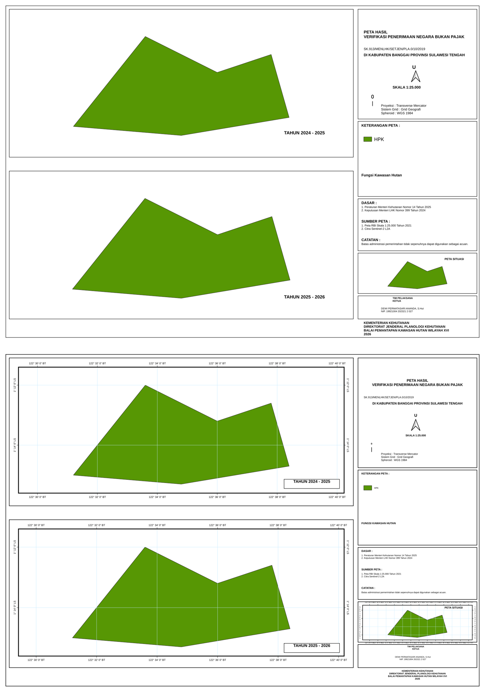
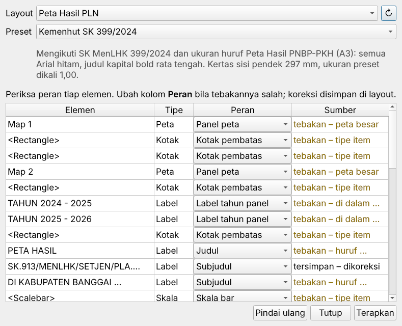

# Rimba Layout

Plugin QGIS untuk mengganti gaya **Print Layout yang sudah ada** dengan satu klik, tanpa memindahkan posisi elemen. Satu keluarga dengan [Rimba Grid](https://github.com/meowtret/rimba_grid).

> Status: versi uji 0.1.0 (eksperimental). Diuji headless di QGIS 3.34.



## Cara pakai

1. Pasang lewat **Plugins → Manage and Install Plugins → Install from ZIP**.
2. Buka layout, klik ikon **Rimba Layout** (toolbar QGIS atau toolbar Layout Designer).
3. Pilih layout dan preset. Periksa tabel peran; ubah kolom **Peran** bila tebakannya salah. Koreksi disimpan di layout.
4. Klik **Terapkan**. Satu **Ctrl+Z** di Layout Designer membatalkan semuanya.

Yang diubah: jenis/ukuran/tebal huruf, kapital, perataan, bingkai label tahun, gaya legenda dan skala, tebal bingkai peta dan kotak, serta grid BT/BB LU/LS (panel utama dan peta situasi). Posisi elemen tidak diubah. Grid yang sudah ada dipakai ulang dengan intervalnya; bila belum ada, grid dibuat dengan interval otomatis (minimal 2 garis per arah, sesuai SK 399/2024).



## Preset bawaan

| Preset | Ciri |
|---|---|
| Kemenhut SK 399/2024 | Semua Arial hitam, judul kapital bold rata tengah, grid garis biru R190 G232 B255, label `122° 33' 0" BT` |
| Klasik | Judul Times New Roman, grid berbingkai zebra |
| Minimalis | Huruf abu tua, tanpa garis grid, tick ke luar |

Ukuran di preset ditulis untuk kertas A3 dan diskalakan otomatis untuk A4 sampai A0.

## Menjalankan uji

Dari OSGeo4W Shell (Windows):

```
python-qgis-ltr tests\test_core.py
python-qgis-ltr tests\test_apply.py
python-qgis-ltr tests\test_dialog.py
```

Di Linux:

```
python3 tests/test_core.py && python3 tests/test_apply.py && python3 tests/test_dialog.py
```

## Lisensi

GPL-2.0 atau yang lebih baru.
