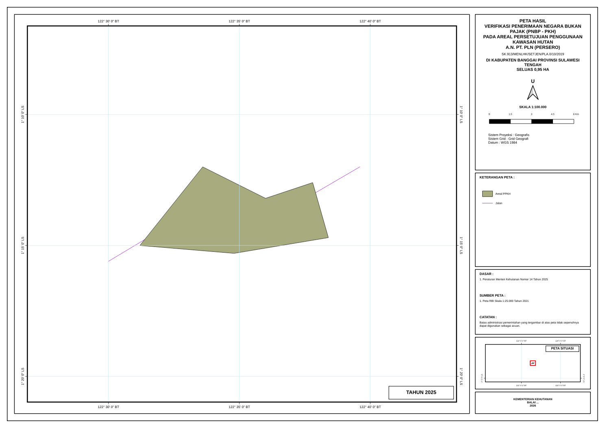
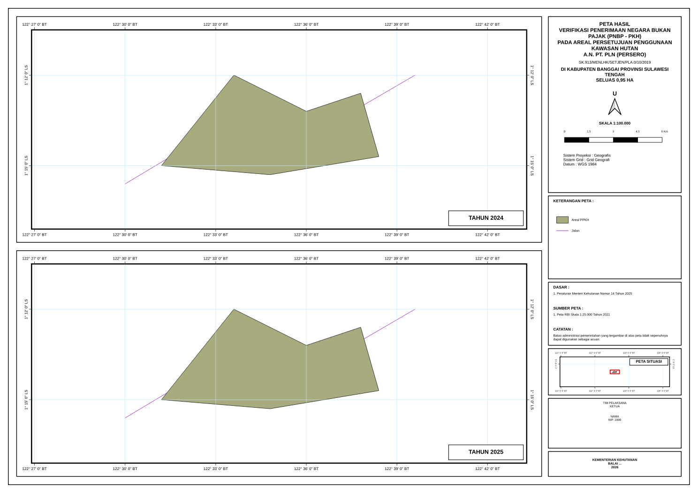

# Rimba Layout

Plugin QGIS untuk **membuat Print Layout lengkap dari preset** dalam satu klik. Peta diambil dari kanvas QGIS; teks informasi tepi diisi lewat form. Satu keluarga dengan [Rimba Grid](https://github.com/meowtret/rimba_grid).

> Status: 0.2.0 (eksperimental). Diuji headless di QGIS 3.34.



## Yang dibuat

- **Panel peta** (satu atau dua) dari layer, cakupan, dan CRS kanvas, atau dari tema peta. Grid geografis berlabel `122° 33' 0" BT` / `1° 12' 0" LS`, skala dibulatkan (1:25.000, 1:50.000, ...), label tahun opsional di pojok panel.
- **Informasi tepi** di kanan: logo (opsional), judul, nomor SK, lokasi/luas, huruf U dan panah utara, skala angka (otomatis mengikuti peta) dan skala bar, catatan proyeksi, keterangan peta (legenda otomatis), dasar, sumber, catatan, peta situasi dengan kotak merah penanda lokasi, blok tanda tangan (opsional), instansi penerbit.
- Ukuran huruf dan garis menyesuaikan kertas **A4 sampai A0** (mendatar).



## Preset bawaan

| Preset | Ciri |
|---|---|
| Kemenhut SK 399/2024 | Semua Arial hitam, judul kapital bold rata tengah, grid garis biru R190 G232 B255, ukuran huruf mengikuti Peta Hasil PNBP-PKH (A3) |
| Klasik | Judul Times New Roman, grid berbingkai zebra |
| Minimalis | Huruf abu tua, tanpa garis grid, tick ke luar |

## Cara pakai

1. Pasang lewat **Plugins → Manage and Install Plugins → Install from ZIP**.
2. Tampilkan layer yang ingin dipetakan dan atur cakupan kanvas.
3. Klik ikon **Rimba Layout**, pilih preset, kertas, dan jumlah panel, lalu isi teksnya. Isian terakhir diingat.
4. Klik **Buat layout**. Layout baru terbuka di Layout Designer dan bisa disunting seperti biasa.


## Menjalankan uji

Dari OSGeo4W Shell (Windows):

```
python-qgis-ltr tests\test_core.py
python-qgis-ltr tests\test_builder.py
python-qgis-ltr tests\test_dialog.py
```

## Lisensi

GPL-2.0 atau yang lebih baru.
